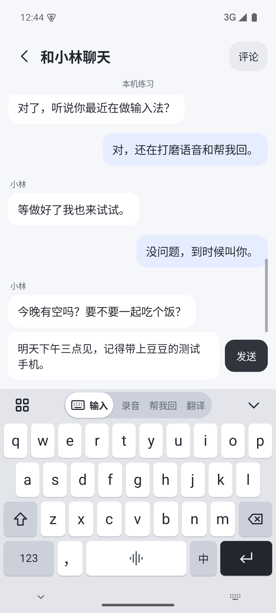
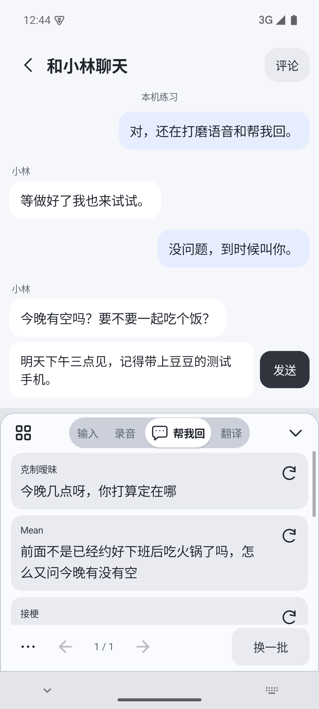
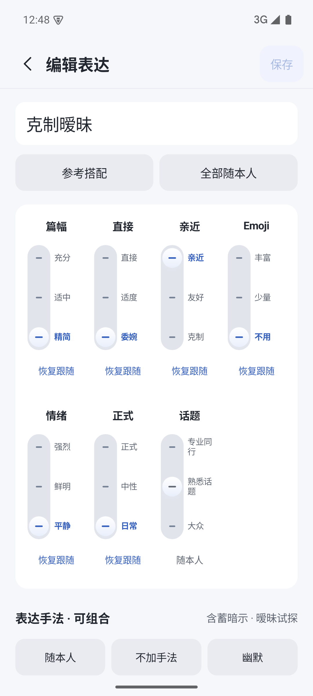
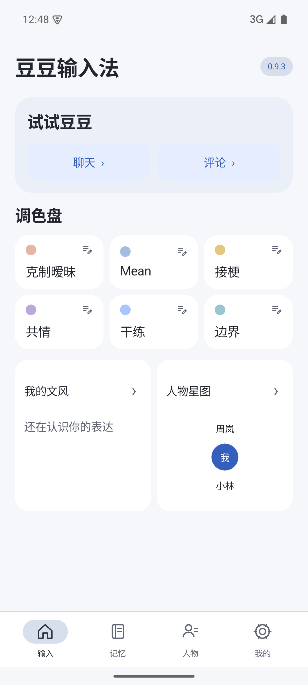
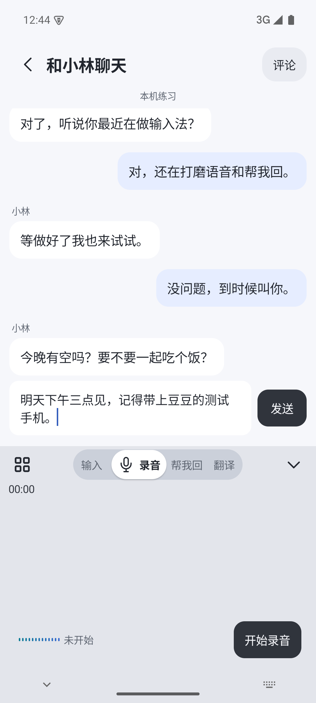
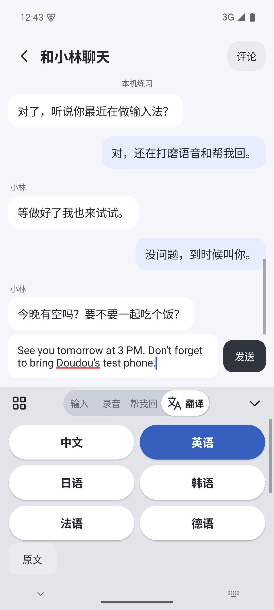

<p align="center">
  
</p>

<h1 align="center">豆豆输入法</h1>

<p align="center">语音输入，也帮你想好怎么回。</p>

<p align="center">
  <a href="https://github.com/Xiamu-ssr/personal-keyboard/releases/download/v0.9.3-alpha.1/doudou-keyboard.apk"><strong>下载 Android APK</strong></a>
  &nbsp; · &nbsp;
  <a href="https://github.com/Xiamu-ssr/personal-keyboard/releases/tag/v0.9.3-alpha.1">版本说明</a>
  &nbsp; · &nbsp;
  <a href="https://xiamu-ssr.github.io/personal-keyboard/">产品与架构</a>
</p>

<p align="center">0.9.3-alpha.1 · Android 11+ · 亮色 / 暗色</p>

当前为邀请内测版。在线功能需账号登录，新账号赠送 3,000 Credit；暂未开放充值。本地拼音无需登录。

## 一眼看看

<table>
  <tr>
    <th align="center">输入</th>
    <th align="center">帮我回</th>
    <th align="center">表达调色盘</th>
  </tr>
  <tr>
    <td align="center"><a href="spec/media/screenshots/typing.png"></a></td>
    <td align="center"><a href="spec/media/screenshots/advisor.png"></a></td>
    <td align="center"><a href="spec/media/screenshots/palette.png"></a></td>
  </tr>
</table>

原生 APK 截图，点击可查看原图；来源版本见素材清单。[全部截图](spec/media/screenshots/) · [使用录屏（0.8.0）](spec/media/recordings/)

## 四个工作区

| 工作区 | 可以做什么 |
| --- | --- |
| **输入** | 离线拼音、表情和符号；按住空格说话，松手填入。 |
| **录音** | 进入后点开始录音，切栏有动态提示。收起键盘继续录，断网或额度不足仍保留原音。 |
| **帮我回** | 读取当前聊天截图，结合人物与文风给出六种回复；可换一组、换说法、回看旧答案。 |
| **翻译** | 九种语言点选即替换输入框；原文暂存，随时还原，换语言不重复翻译译文。 |

六个调色盘槽位都可命名、调节表达属性。热词、场景文风和人物资料随账号同步；历史、截图和录音原件留在手机。

<details>
<summary><strong>更多界面</strong></summary>

<table>
  <tr>
    <th align="center">首页</th>
    <th align="center">录音笔</th>
    <th align="center">翻译</th>
  </tr>
  <tr>
    <td align="center"><a href="spec/media/screenshots/home.png"></a></td>
    <td align="center"><a href="spec/media/screenshots/recorder.png"></a></td>
    <td align="center"><a href="spec/media/screenshots/translation.png"></a></td>
  </tr>
</table>

截图与录屏集中在 [spec/media/](spec/media/)。每份材料的来源版本与校验值分别记录在 [截图清单](spec/release.json) 和 [录屏清单](spec/media.json)；旧录屏保留其真实版本。

[评论练习](spec/media/screenshots/comments.png) · [人物资料](spec/media/screenshots/people.png) · [积分用量与价格](spec/media/screenshots/credits.png)

</details>

<details>
<summary><strong>积分与在线服务</strong></summary>

转写、语音整理、帮我回和翻译共用 Credit，按实际模型用量结算。1 Credit = 0.001 元；失败不扣、取消释放预留，同一请求重试不重复扣分。查看历史、旧答案和个人记忆不扣分。

当前费率采用阿里云北京公开标准价上浮 75%。每 1,000 Token 的输入与输出分别计价：

| 模型 | 输入 Credit | 输出 Credit |
| --- | ---: | ---: |
| Qwen Message 语音识别 | 10.5 | 7.875 |
| Qwen3.8-Flash 帮我回 / 整理 / 翻译 | 1.4 | 4.725 |

每个任务冻结计价版本，预留后按用量退余；账单可查看用量与费率。自动记忆学习计入服务成本，不另扣分。套餐和费率分别在 [plans.json](cloud/config/plans.json)、[credits.json](cloud/config/credits.json) 管理。

个人记忆同步属于基础账户能力；完整文字与截图的云备份按权益开放，录音原音仅在本机。

</details>

<details>
<summary><strong>开发、架构与部署</strong></summary>

| 目录 | 职责 |
| --- | --- |
| [app/](app/) | 原生 Android App 与输入法，Gradle 应用模块位于 `app/app/`。 |
| [cloud/](cloud/) | 账号、Credit 账本、模型代理、个人记忆、任务与管理后台。 |
| [spec/](spec/) | YAML 架构与业务图、提示词、验证清单，以及公开展示素材。 |

模型请求统一经过 Cloud，供应商密钥只保存在服务端。Cloud 使用独立 API、PostgreSQL 两个容器及持久卷，经 HTTPS 反向代理对外服务。[Cloud 运行说明](cloud/README.md)

**本地构建**

需要 Node 22+、Python 3、JDK 17、Android SDK 35、NDK 27.0.12077973、CMake 3.22.1。设置 `ANDROID_SDK_ROOT` 后运行：

```sh
npm ci
npm run android:build
npm run android:test
npm run android:sanitize
npm run check
```

APK 输出至 `spec/demo/doudou-keyboard.apk`，版本与摘要见 [artifact.json](spec/demo/artifact.json)。沿用发布签名方可覆盖安装。

**查看 SPEC**

```sh
npm ci
npm run spec:serve
```

打开 `http://127.0.0.1:8560`。媒体自动从 `spec/media/` 校验并复制到展示目录，无需 Android SDK；本地 APK 下载需先构建或从 Release 下载。公开页提供截图、录屏和 APK，不连接个人设备。

[规格源](spec/spec.yaml) · [验证摘要](spec/verification.json) · [ECS 镜像](https://106.14.73.99/keyboard-spec/) · [Cloud 后台](https://106.14.88.147/keyboard-api/admin/)

**发布约定**

Release 附件只保留 `doudou-keyboard.apk` 与 `SHA256SUMS`。截图在 `spec/media/screenshots/`，录屏在 `spec/media/recordings/`，可在 README 或 Release 正文引用。Pages 从仓库取媒体、从 Release 取 APK；展示前校验全部文件的来源和摘要。

</details>

---

离线拼音基于 AOSP / libgooglepinyin。现代词库派生自 [万象词库](https://github.com/amzxyz/rime-wanxiang-data)，采用 CC BY 4.0；固定版本与重建方法见 [词库来源](app/lexicon/source.json)。
